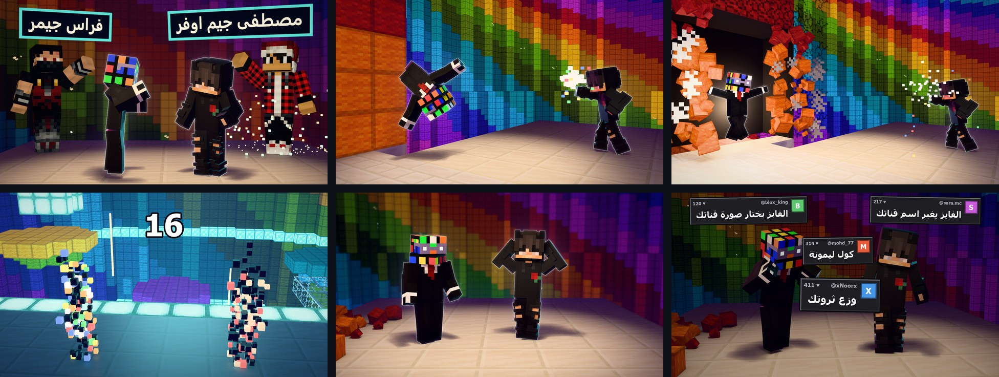

# DROPPER Intro

**A 17.75 second Arabic Minecraft intro, animated entirely in code.**
Two players, two guests out of eggs, one punch through a wall, 16 levels, and a very unfair scoreboard.

**[▶ Watch with speech](videos/dropper_intro_with_speech.mp4)** · **[▶ Watch with sound effects only](videos/dropper_intro_sfx_only.mp4)**

## Two versions, same picture

| Version | What you hear |
|---|---|
| [With speech](videos/dropper_intro_with_speech.mp4) | The voices and every sound effect |
| [Sound effects only](videos/dropper_intro_sfx_only.mp4) | The effects alone, no voices |

## Highlights

- **1065 frames** at 1920x1080 and 60 fps, with no timeline editor: poses, cameras, light and timing are all code.
- **Timed to the speech:** the guests appear on their names and the cuts follow the phrases.
- **A wall that breaks block by block:** crack stages, flying chunks, dust, and a hole that stays.
- **Two worlds:** a rainbow wool room and a glowing water shaft.
- **Correct Arabic:** joined letters, right to left, on signs, the scoreboard and the comments.

## How it works

1. **Art:** Python draws the skins' mouths, the signs, the scoreboard and the comment cards.
2. **Scene:** Blender scripts build the world, animate it and render every frame.
3. **Finish:** Python adds the outline, glow and grading, and places the 2D cards.
4. **Sound:** each effect is placed on the frame of the action it belongs to, then FFmpeg joins it all.

The main files are [`full5.py`](03_scripts/full5.py) (the whole intro), [`post5.py`](03_scripts/post5.py) (the finish) and [`sound6.py`](03_scripts/sound6.py) (the sound).

## Built with

Blender 5.2 (Python API) · Python (NumPy, Pillow, arabic-reshaper, python-bidi) · FFmpeg

## About this repo

This is a showcase, not a template. The scripts are here to read: the skins, textures, fonts, sounds and recordings they need are not included, so they will not run on their own. The videos here are compressed to load quickly.

Not an official Minecraft product. Not approved by or associated with Mojang or Microsoft.
